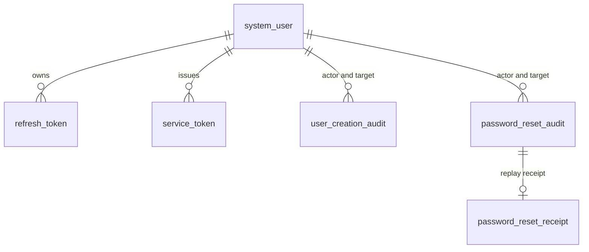

# synkro-auth-db

> Auth schema migrations, roles, grants and audit structures in the shared PostgreSQL instance.

Part of the **SynkroTech SAS Sales Management System**. Architecture, decisions and
contracts live in [synkro-docs](https://github.com/code-corhuila/synkro-docs).

**Quick start:** start PostgreSQL through synkro-infra-postgres, configure the migration credentials, then invoke `auth-db-migrate` from this root. See [Getting started](#getting-started).

## What it does

- Owns auth_schema, its tables, indexes and Flyway ledger.
- Versions human/session/service-token data structures and administrative audit/receipt storage.
- Grants restricted reader/writer access to the infrastructure-created auth_app login.
- Keeps applied migrations immutable and provides explicit reverse/rebuild verification.

## Where it fits



Infrastructure owns the PostgreSQL container, database, application login and volume. This repository contributes its tooling migration runner; application code connects with auth_app.

## Tech stack

| Component | Choice |
|---|---|
| Engine | PostgreSQL 16; shared instance, domain schema |
| Migration tool | Flyway 11.20.3 |
| Runner | auth-db-migrate; one-shot tooling profile |
| Verification | Real PostgreSQL rebuild, permissions and constraint checks |

## Dependencies

| Depends on | Purpose | Configuration |
|---|---|---|
| synkro-infra-postgres | Database, login and lifecycle | External platform network |
| Administrative migration credentials | Apply DDL/DCL; never runtime app credentials | FLYWAY_URL / FLYWAY_USER / FLYWAY_PASSWORD |
| auth_app | Receives the owning application grants | Provisioned by infrastructure |

## Getting started

Use **PowerShell or Bash** from this repository root after infrastructure has created a healthy database and the application login. Populate the ignored `.env` from `.env.example` with protected migration inputs.

```text
docker compose -f deploy/compose.yml --env-file .env run --rm auth-db-migrate
docker compose -f deploy/compose.yml --env-file .env run --rm auth-db-migrate validate
```

Repeat application must apply no completed migration again. Standalone disposable-database setup and reconstruction instructions are preserved in the guides below.

For the complete platform, start from [synkro-infra-postgres](https://github.com/code-corhuila/synkro-infra-postgres).

## Configuration

The committed [.env.example](.env.example) is the configuration inventory.
Its values are examples; required inputs and defaults follow its comments and the
owning implementation. Keep real secrets in protected local files.

| Variable | Purpose |
|---|---|
| `FLYWAY_URL` | Connection address, origin or build-time entry point |
| `FLYWAY_USER` | Connection or administrator identity |
| `FLYWAY_PASSWORD` | Credential supplied locally |

## Interface

| Structure | Responsibility |
|---|---|
| system_user / refresh_token | Human identity and renewable sessions |
| service_token / idempotency_key | Service-token metadata and replay ownership |
| user_creation_audit | Append-only registration attribution |
| password_reset_audit / password_reset_receipt | Permanent reset attribution and expiring private replay receipt |
| auth_reader / auth_writer | Restricted domain privileges |

The receipt is separate from the current user hash. Audit and receipt cleanup rules are detailed in the schema guide.

## Project structure

```text
01_ddl/         schema, tables, constraints and indexes
02_dml/         approved data changes
03_dcl/         roles and grants
04_tcl/         transactional operations
05_rollbacks/   explicit U scripts by migration family
deploy/         one-shot Flyway Compose runner
flyway.toml     schema and owning ledger selection
docs/           migration, schema and verification procedures
```

## Testing

From this root:

```text
python3 tests/test_history_contract.py
```

On Windows with the Python launcher, use `py -3` in place of `python3`. The owning database CI contains the real empty/repeat/constraint/privilege/rollback/rebuild checks. Reverse scripts are for explicitly disposable verification or a reviewed recovery, never an automatic reset of an established environment.

## Branching and contributing

Use a `feat/`, `fix/` or `chore/` child branch and a PR into `develop`.
Permanent branches are `develop`, `qa` and `main`; none accepts direct commits.
Promote through a `qa-<description>` or release child with `git cherry-pick -x`.
`main` requires approval from `ariel5253`. Use English Conventional Commits.
See [Git conventions](https://github.com/code-corhuila/synkro-docs/blob/main/00-governance/git-conventions.md).

## Further documentation

- [Schema](docs/schema.md).
- [Migrations](docs/migrations.md).
- [Ci rebuild check](docs/ci-rebuild-check.md).
- [Root composition](docs/root-composition.md).
- [Domain rules](https://github.com/code-corhuila/synkro-docs/blob/main/02-domain/entities-and-rules.md), [contracts](https://github.com/code-corhuila/synkro-docs/tree/main/07-api/contracts/openapi) and [testing strategy](https://github.com/code-corhuila/synkro-docs/blob/main/11-quality/testing-strategy.md).

<!-- Preserve previously published README section links. -->
<a id="branching"></a>
<a id="layout"></a>
<a id="schema-tables-and-roles"></a>
<a id="the-user-creation-audit"></a>
<a id="the-password-reset-audit"></a>
<a id="the-password-reset-receipt"></a>
<a id="cleanup-of-expired-receipts"></a>
<a id="running-the-migrations-locally"></a>
<a id="the-ci-rebuild-check"></a>
<a id="root-composition-integration-hu-inf-02"></a>
